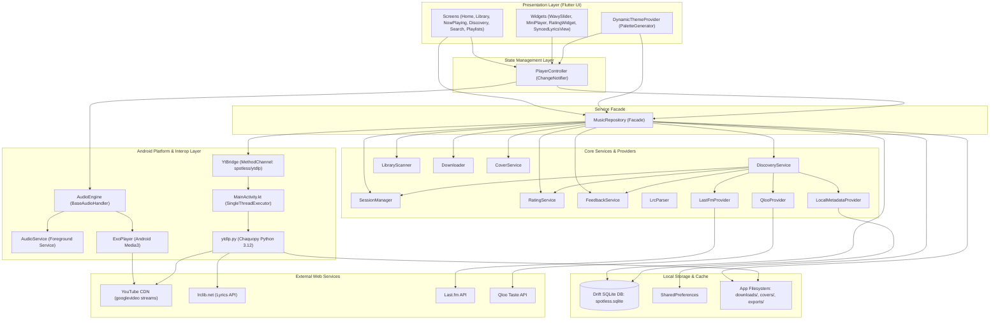
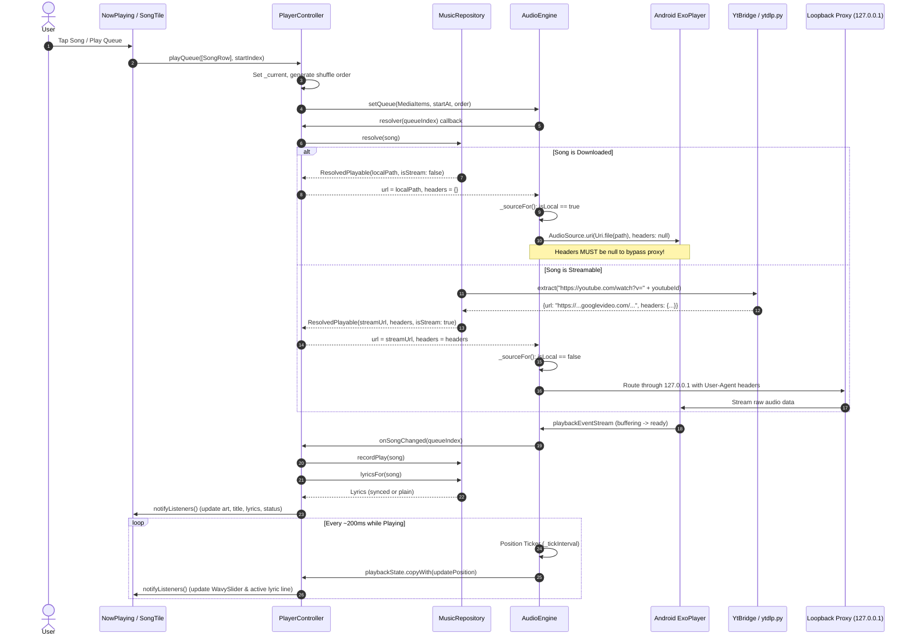
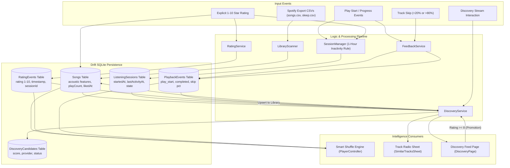
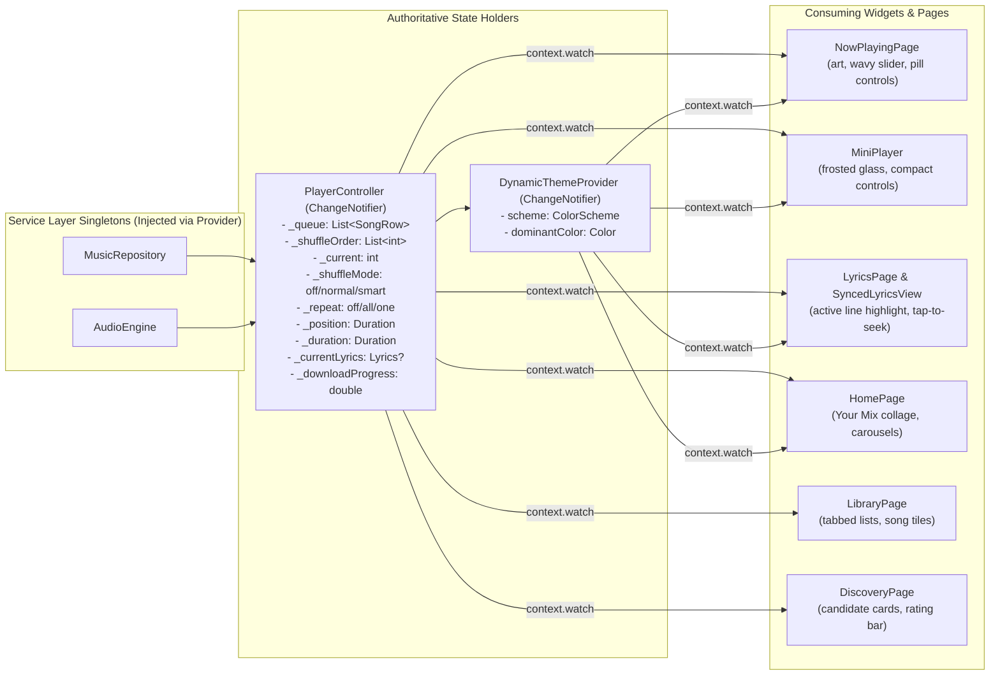
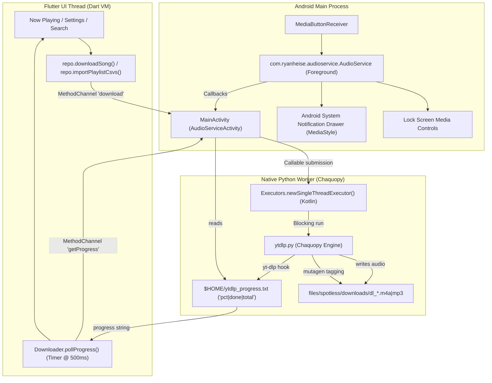

# 03 — Spotless Architecture and System Design

> **Document Version**: 1.0.0  
> **Date**: November 1, 2026  

---

## 1. High-Level Architectural Pattern

Spotless employs a **Layered Architecture with a Centralized Facade & Unidirectional Reactive State Flow**:

1. **Presentation Layer (UI)**: Built with Flutter Material 3 Expressive components. UI widgets **never** talk directly to SQLite, ExoPlayer, or Python. They communicate exclusively through `PlayerController` (for playback & queue state) and `MusicRepository` (for queries, playlists, and catalog actions).
2. **State Management Layer**: Implemented using `ChangeNotifier` and Flutter `Provider`. `PlayerController` is the authoritative owner of the active queue, shuffle sequence, position, and playback flags. `DynamicThemeProvider` extracts palettes from album art to drive ambient styling.
3. **Facade Layer (`MusicRepository`)**: The boundary between UI and backend subsystems. Encapsulates SQLite database operations, external provider orchestration, download queuing, cover caching, and library imports.
4. **Audio Engine Layer (`AudioEngine`)**: Wraps `just_audio` and `audio_service`, running ExoPlayer natively on Android. Coordinates background media notifications, dual-player crossfades, and ~200ms position ticking.
5. **Native Interop Layer (`YtBridge` & Chaquopy)**: A Flutter `MethodChannel` (`spotless/ytdlp`) dispatching tasks to an embedded Python 3.12 runtime running `yt-dlp` and `mutagen` on a dedicated background worker thread.
6. **Data Persistence Layer (Drift SQLite)**: Relational schema v3 with 8 tables storing catalog metadata, lyrics, playlists, sessions, ratings, playback events, and discovery candidates.

---

## 2. Minimum Architectural Diagrams

### A. High-Level Architecture Diagram

---

### B. Playback Architecture Diagram (Track Selection to Audio Output)

---

### C. Data-Flow Diagram (Metadata, Feedback, Sessions & Recommendations)

---

### D. State Management & Ownership Diagram

---

### E. Background-Task Architecture (Downloads & Media Playback)

---

## 3. Explaining Important Architectural Connections

### 3.1 The ExoPlayer Localhost Proxy Bypass (`_sourceFor`)
When ExoPlayer requests an audio stream, `just_audio` inspects the `AudioSource.uri(uri, headers: headers)` call:
- If `headers` is **not null** (even an empty map `{}`), `just_audio` spins up an internal HTTP proxy at `http://127.0.0.1:<random_port>/...`.
- If the URI is a local path (`/storage/...`), passing headers makes ExoPlayer attempt cleartext HTTP to `127.0.0.1`.
- Android 9+ blocks cleartext HTTP by default.
- **Solution in Spotless**:
  1. `AudioEngine._sourceFor()` verifies `uri.scheme.isEmpty || uri.scheme == 'file'`. If true, it wraps as `Uri.file(path)` and enforces `headers: null`.
  2. For remote streams (`googlevideo.com`), headers are required for YouTube bot bypass. `android/app/src/main/res/xml/network_security_config.xml` explicitly allows cleartext traffic to `127.0.0.1` and `localhost`.

### 3.2 Dual-Player Audio Crossfade (`_player` & `_aux`)
`AudioEngine` owns two instances of `AudioPlayer`:
1. When song A approaches completion or the user taps next, `_aux` loads song B at `volume = 0.0`.
2. `unawaited(_aux.play())` starts playback on `_aux` immediately.
3. `_fadeVolume` executes 16 discrete volume steps over 4 seconds: `_player` ramps from 1.0 to 0.0 while `_aux` ramps from 0.0 to 1.0.
4. Once completed, `old.stop()` shuts down the previous track, the references swap (`_player = next; _aux = old;`), and event listeners are reattached.

### 3.3 MethodChannel Python Interop & Thread Safety
Chaquopy runs Python inside the Android JVM. In `MainActivity.kt`:
- Calls to `ytdlp.py` are submitted as a `java.util.concurrent.Callable<PyObject>` to a `singleThreadExecutor`.
- The platform channel thread never blocks on Python; a dedicated daemon `waiter` thread awaits `future.get(timeoutSecs, TimeUnit.SECONDS)`.
- If a download or network call hangs, it aborts after 300s (or 90s for metadata) with a clean `YTDLP_ERROR` platform exception rather than freezing the Flutter UI.
- All Python return values are JSON strings (`json.dumps(..., ensure_ascii=False)`), preventing encoding corruptions across the native JNI boundary.
