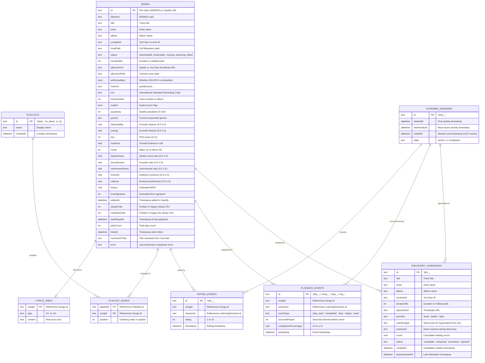

# 05 — Database and Data Model Documentation

> **Document Version**: 1.0.0  
> **Date**: November 1, 2026  
> **Technology**: Drift 2.34.3 SQLite ORM (`drift_flutter` 0.3.1)  
> **Database File**: `app_flutter/spotless.sqlite` on Android  
> **Current Schema Version**: 3  

---

## 1. Entity-Relationship Diagram (Drift Schema v3)



---

## 2. Table Specifications

### 2.1 `Songs` (`SongRow`)
- **Primary Key**: `id` (`TextColumn`).
  - Pre-seeded local songs: zero-padded string (`"0000001"`, `"0000002"`, ...).
  - Spotify-imported tracks: Spotify track URI (`"spotify:track:..."`) or `"imp:<playlistId>:<i>"`.
  - YouTube search tracks: `"yt:<videoId>"`.
- **Status Enum Mapping**: Stored as text column matching `SongStatus.name`:
  - `'analyzing'`: Metadata created, awaiting download.
  - `'downloaded'`: File present at `localPath` on disk.
  - `'streamable'`: YouTube ID known; playable over network.
  - `'missing'`: No local file and no YouTube ID known.
  - `'failed'`: Download or extraction failed; see `error` column.
- **Full Spotify Acoustic Vectors**: `danceability`, `energy`, `key`, `loudness`, `mode`, `speechiness`, `acousticness`, `instrumentalness`, `liveness`, `valence`, `tempo`, `timeSignature`.

### 2.2 `LyricsTable` (`LyricsTableData`)
- **Primary Key**: `songId` (`TextColumn`).
- **Columns**: `type` (`'lrc'` for synced, `'txt'` for plain), `content` (`TextColumn` storing raw lyrics).
- **Encoding**: UTF-8 encoded plain text. Supports non-Latin scripts (Telugu, Tamil, Devanagari, Japanese).

### 2.3 `Playlists` (`Playlist`)
- **Primary Key**: `id` (`TextColumn`).
- **Seeded Playlists**: Migrated from legacy CSVs:
  - `id: 'sleep'`, `name: 'Sleep'`
  - `id: 'no_sleep'`, `name: 'No Sleep'`
- **User Playlists**: `id: 'pl_<timestamp>'`.
- **Date Storage**: Stored as unix-epoch milliseconds integer in SQLite, mapped to Dart `DateTime`.

### 2.4 `PlaylistSongs` (`PlaylistSong`)
- **Composite Primary Key**: `{playlistId, songId}`.
- **Positioning**: `position` (`IntColumn`) manages drag-and-drop playlist ordering.
- **Safe Inner Join**: When adding songs that are not yet downloaded, `addToPlaylist()` inserts a stub row into `Songs` with `status = 'streamable'` so inner joins succeed.

### 2.5 `ListeningSessions` (`ListeningSession`)
- **Primary Key**: `id` (`TextColumn`, format: `sess_<ms>_<us>`).
- **Timestamps**: `startedAt`, `lastActivityAt`, `endedAt`.
- **State**: `'active'` while within the 1-hour continuity window; marked `'completed'` when gap $\ge 1\text{ hour}$.

### 2.6 `RatingEvents` (`RatingEvent`)
- **Primary Key**: `id` (`TextColumn`, format: `rate_<ms>_<random>`).
- **Rating Scale**: Enforced integer between `1` and `10`.
- **Immutability**: Past ratings are never updated or deleted. Every user rating tap generates a new historical row tied to the current session.

### 2.7 `PlaybackEvents` (`PlaybackEvent`)
- **Primary Key**: `id` (`TextColumn`, format: `<eventType>_<ms>_<random>`).
- **Event Types**:
  - `'play_start'`: Generated by `FeedbackService.recordPlayStart()`.
  - `'completed'`: Generated when track finishes (`completionPercentage = 1.0`).
  - `'skip'`: Generated when user skips before completion; stores exact `secondsPlayed` and `completionPercentage`.
  - `'replay'`: Generated when user immediately restarts the track.

### 2.8 `DiscoveryCandidates` (`DiscoveryCandidate`)
- **Primary Key**: `id` (`TextColumn`).
- **Provider Names**: `'Local Library'`, `'Last.fm'`. (Qloo removed 2026-11-01.)
- **Lifecycle**:
  - Initial: `'candidate'`
  - User plays candidate: `'streamed'`
  - User likes candidate ($\ge 8$): `'promoted'` (promoted tracks are upserted into `Songs`)
  - User dislikes candidate: `'rejected'`
- **Purge**: Unpromoted candidates older than 14 days are deleted by `cleanupStaleCandidates()`.

---

## 3. Schema Migrations (`MigrationStrategy`)

### Version 1 $\rightarrow$ Version 2
- Added `Playlists` table and `PlaylistSongs` table.
- Added `likedAt` datetime column to `Songs` table.
- Seeded `'sleep'` and `'no_sleep'` playlists using typed `PlaylistsCompanion` inserts:
  ```dart
  await db.into(db.playlists).insert(
    PlaylistsCompanion.insert(
      id: 'sleep',
      name: 'Sleep',
      createdAt: DateTime(2026, 1, 1),
    ),
  );
  ```
  *(Crucial fix: avoids raw text date string literals that fail Drift integer timestamp parsing).*
- Executed custom SQL statements to populate `playlist_songs` from `sleep_order` and `no_sleep_order`.

### Version 2 $\rightarrow$ Version 3
- Added `ListeningSessions` table.
- Added `RatingEvents` table.
- Added `PlaybackEvents` table.
- Added `DiscoveryCandidates` table.

---

## 4. Persistence Limitations & Constraints

1. **Local Filesystem Coupling**: The `Songs.localPath` column stores absolute filesystem paths (e.g., `/storage/emulated/0/Download/songs_download/music/0000001.mp3` or `/data/user/0/com.nandhu.spotless/files/spotless/downloads/dl_1730000.m4a`). If the user moves their library folder, `LibraryScanner.scan()` must be run to re-link disk paths.
2. **Single SQLite Database Connection**: Drift uses a single database connection. Background isolate tasks (such as intensive downloads) use the existing database instance via `MusicRepository`.
3. **No Network Sync**: The database is purely local to the device. There is no cloud sync or multi-device account state.
